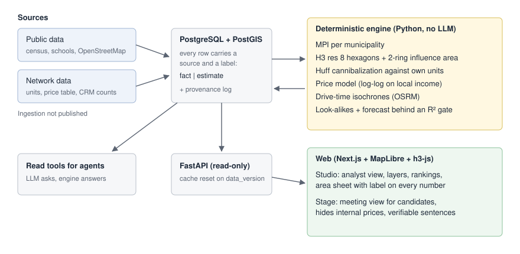

# GeoIntelligence

Geographic intelligence for expanding a premium early-childhood education network: which city to enter, which neighborhood to open in, how much a new unit would take from the existing ones, and what tuition the area can support.

I designed and built it as an intrapreneurship project inside a school network with 35 units in São Paulo state. This repository is a case study. The code, the network's data and the ingestion pipelines are not published.

## The problem

Expansion decisions were made city by city, without a shared base of data. Every proposal for a new unit (from the expansion team or from a franchise candidate) started from scratch, and nobody could say how a new address compared with the units that already existed.

The tool had to answer "where should we open" with numbers that a director could defend and that a franchise candidate could check in a meeting.

## How it works

The engine is deterministic Python on PostgreSQL + PostGIS, with no LLM in the calculation path. Every number it produces carries a source and a label, `fact` or `estimate`, and the interface never hides the label.

It works at two levels.

**Country, by municipality.** A Market Potential Index (MPI) combines income fit, demand (children 0 to 6 in high-income households), unmet premium demand and a saturation penalty. Weights live in versioned YAML, not in code. A guardrail forces a low score where there are too few high-income households, so a large but low-income city cannot rank high on volume alone.

**City, by hexagon.** Each city is split into H3 resolution 8 hexagons (about 0.7 km²), and each hexagon is scored by its influence area (itself plus two rings, about 2 km). The expansion score is the local MPI adjusted by:

- cannibalization: the share of the area's high-income children who already live within a few kilometers of an existing unit (the area sheet adds a Huff gravity model across the network, the candidate point and competing private schools);
- urban context and birth trend signals, each capped at a small adjustment relative to the city.

On top of that:

- **Tuition estimate.** A log-log model of the network's own price against household income around each unit predicts the price band an area supports. It predicts the network's price, not the market average, and the interface says so.
- **Drive-time isochrones.** An OSRM server computes 10, 15 and 20 minute areas by car, shown next to the fixed-radius numbers, with a traffic factor kept in config as an assumption to calibrate.
- **Look-alikes.** Each hexagon is compared with the areas around current units ("twin" neighborhoods and cities).

## Forecasts behind a gate

The engine can also try to forecast visits and enrollments for a new area. A forecast is published only if it passes leave-one-out validation with R² of at least 0.2. With the data available so far it does not pass, so the interface does not show one. A backtest of the current units against the city ranking is part of the same discipline: it checks whether the score says anything about how the units perform before anyone trusts it for new ones.

## Interface

A web app in Next.js with MapLibre and h3-js reads the engine through a read-only FastAPI layer. The API watches a `data_version` table and drops its cache when any pipeline writes, so it never needs a restart after a refresh.

It has two modes:

- **Studio**, for the expansion team: layer toggles, city and neighborhood rankings with filters, and an area sheet that explains why a hexagon scored the way it did, factor by factor.
- **Stage**, for meetings with franchise candidates: hides the panel and internal prices and shows short sentences that can be checked against the map. The URL carries city, point and mode, so a sheet can be shared as a link.

The same engine is exposed as read tools for an LLM agent. The agent asks questions; the numbers still come from the engine.

## Data handling

- Public sources: census data by tract, the national school catalog and OpenStreetMap.
- Internal sources: the network's units and price table, plus counts from the CRM aggregated by unit and month. Names, phones, emails and free text from the CRM are never read; objections are reduced to "price" or "other".
- Credentials come from the environment, the CRM connection is read-only, and backups that contain addresses go to a restricted location.

## Stack

Python, PostgreSQL + PostGIS, H3, OSRM, FastAPI, Next.js 15, MapLibre GL, h3-js, pytest. Pure logic (normalization, demand estimate, MPI, cannibalization, price model, validation gates) is tested without a database.

## What I did

Identified the problem, defined the product and built it end to end: data model, engine, API, both interfaces, refresh routine and backups. I am also responsible for running it in production.
